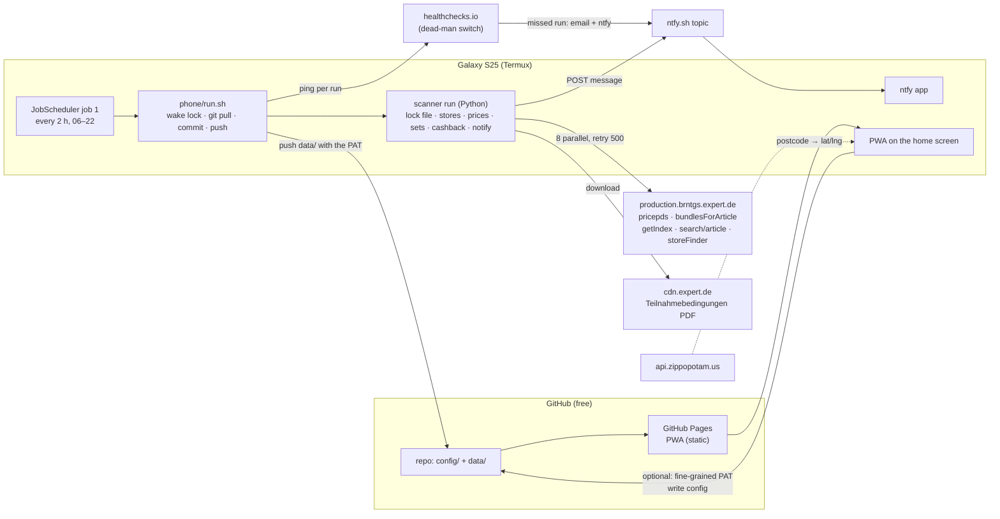

# expert-checker — plan

Status: draft for review, 2026-11-21, revised after the first review (German UI, Berlin location, redesigned prototype); §1, §2, §3, §6 and §7 revised 2026-11-23 after the phone test (the scanner runs on the phone, §3). Builds on [requirements.md](requirements.md) and [expert-api.md](expert-api.md). Feature list: [features.md](features.md). Clickable prototype: [prototype/index.html](../prototype/index.html), published at https://claude.ai/artifact/Cf3Y6zg8fAqWNPkKaELWdt (run locally with `python3 -m http.server 8765 --directory prototype`). Revised and final prototype (card B2, 2026-11-22): [prototype/b2.html](../prototype/b2.html), published at https://claude.ai/artifact/Y1dntJo3RAE6oRvnXTK2h2.

## 1. Decisions on the open questions

The open questions in requirements.md were analyzed with live API calls on 2026-11-21 (promotion index of the online shop, Freital and Pasternak; article lookups; the Sony and Samsung cashback PDFs). Results:

| # | Question | Decision | Evidence |
|---|---|---|---|
| 1 | Hosting | **Superseded 2026-11-23: the scanner runs on the phone (§1, "Hosting decision 2026-11-22", and §3).** Original decision: GitHub Actions cron in a public repo. Milestone 0 is a 3-day probe, because the API host *is* behind Cloudflare (`server: cloudflare`, `cf-ray`) and GitHub runners use Azure data-center IPs. Cloudflare Workers are ruled out: the free plan allows 50 external subrequests per invocation; a scan needs 349. Fallback if the probe fails: Oracle Cloud "Always Free" VM with cron (needs a card at signup, no charge). | Response headers of `pricepds`; Cloudflare Workers limits; GitHub Actions docs. |
| 2 | App type | **PWA on GitHub Pages + ntfy push (ntfy.sh, Android app).** Data = JSON files the scanner commits into the repo. The phone is a Samsung Galaxy S25 (Android, confirmed 2026-11-21), so web push has no iOS limits; it stays version 2 because the scanner would have to store push subscriptions and sign VAPID requests; ntfy needs one `POST`. | ntfy docs. |
| 3 | Cashback amounts | **Parse the Teilnahmebedingungen PDF on `cdn.expert.de`** that the promotion description links. Samsung and Sony PDFs hold model-code tables (`Modell-Code / Zoll / Cashback`, `Bezeichnung / SAP / Cashback / Double-Cashback`). `possibleDiscountRanges` is `null` for TV cashbacks (it is filled only for household appliances: Bosch, Siemens, AEG). Manual override file for unparsed brands. | PDFs of `e_4294` (Sony) and `e_4288` (Samsung Frame Pro); `compactPromotionData`. |
| 4 | Qualifying devices | **TVs: from `getIndex.indexed` (complete for expert's range). Soundbars: not linked** (Sony cashback `e_4294` → 8 TVs, 0 soundbars). Soundbar list comes from the PDF; expert articles for them are found through the TV article's `additionalArticles` cross-sell list (numeric ids → `search/article?articleId=e_<id>`), matched by model code. Manual add as fallback. | `indexed` reverse map; `search/article` response. |
| 5 | Samsung offers | At expert today: `e_4288` "Samsung Cashback" = **The Frame Pro Deals** (16.11.–6.12.2026, 130–250 €, TV only, 4 articles). `e_4309` "Samsung Black Weeks" is a marketing pill with 19 TVs and soundbars, no cashback. **Mix & Match (TV + sound device) ended 15.11.2026**; its PDF uses the same table layout as Frame Pro, so one Samsung parser covers both. Mix & Match rule confirmed: TV and soundbar may be bought at different retailers on different dates, registered together. | `globalPromotions`; Samsung Mix & Match and Frame Pro PDFs. |
| 6 | Discover offers without a product | **One `getIndex` call for the online shop per discovery run.** Store promotion sets are subsets of the online set (Freital: 3 online-only, Pasternak: 12 online-only, 0 store-only); the online-only ones are PayPal, PAYBACK and WERO10. | Diff of 3 indexes. |
| 7 | Store distance | **Postcode → coordinates with `api.zippopotam.us/de/<plz>`** once, stored in config. Store coordinates come from the store finder (348 stores with `latitude`/`longitude`). Haversine distance. | Tested with 01705 → Freital. |
| 8 | Other shops | Out of scope. Note: Samsung and Sony PDFs state "all participating retailers", so the cashback data model is shop-independent; a second price source could plug into the same offer. | PDFs. |

New API facts found during the analysis are recorded in [expert-api.md](expert-api.md) (section "Findings 2026-11-21").

### Decisions from the first review (2026-11-21, afternoon)

- **UI language German**, documentation English.
- **Location 14167 Berlin, radius 50 km.** Nearest stores: Berlin Tauentzien 4 km, Falkensee 21 km, Rangsdorf 25 km, Königs Wusterhausen 31 km, Fürstenwalde 50 km. Store names in the finder are partly generic ("ESC"); the app shows "expert <city>" plus postcode and street.
- **Alerts:** default = every price drop; per product switchable to target price or minimum drop (rule N1 changes accordingly).
- **Store links:** every store row links to `https://www.expert.de/shop/<webcode>-<slug>.html?branch_id=<store id>` and shows the postcode with a copy button, because the expert.de store picker works by postcode.
- **Online-Shop explained in the UI:** expert's central shop, ships from the central warehouse, own price, stock and codes (WERO10).
- **Product images:** `GET /api/search/article` → `primaryImage` id → `GET /api/medium/<id>` → `originalData` path → `https://cdn.expert.de/<originalData>`. Scanner stores a 640 px copy in `data/img/<webcode>.jpg`.
- **Product search:** no search endpoint exists (13 path variants probed, all `400 (Bad Request)` or `404`). Version 2 option: a name search over a cached article list built from the promotion index (17 841 article ids of the online shop, resolved once with `search/article`). Version 1 keeps the URL input.
- **Targets:** Philips 65OLED951 (webcode 11128346052, `e_977673`) and Sony BRAVIA 9 II 65"/75" (11128378730 / 11128379730). The Sony cashback (TV Winter 2026) covers BRAVIA 7 II and 8 II only; the 9 II has a set deal with the Theatre Bar 6 (−100 €) and no cashback.
- **Prototype design:** category-standard price-tracker look (white cards, product image per row, two prices side by side: Versand | Abholung, each naming its place; green = cheapest path), chosen by the user from a four-direction board. Design system recorded in DESIGN.md and .impeccable/design.json after the finish review (verdict: ship). Direction board (the four variants shown to the user): https://claude.ai/artifact/MJay7HjM79yGnRVh9SvQ26.
- **Prototype design, revised (2026-11-22):** the two-column price row is replaced by card B2. Card head: product image, name, subtitle, no price. Receipt rows: the cheapest path first (place, distance, stock, Aussteller badge, "kein Cashback" or "ohne Cashback"), the cashback deduction with its dates, the total "Dein Preis inkl. Cashback" (only with a cashback; otherwise the first row is the big price), the other path with "mit Cashback X €", set deals marked "nicht im Preis". Footer: 30-day sparkline of the daily best price, the movement ("−80 € seit gestern" or "−240 € in 30 Tagen") and the verdict ("Tiefstpreis seit 30 Tagen" or "60 € über dem 30-Tage-Tief von 3.399 €"); "Mehr" expands stores within the radius, the three cheapest shippers and all promotions including Zugaben. Green only when the effective price (after cashback) is the lowest of the last 30 days and at least 3 % under the 30-day high; the target price is optional. Product page: hero image, receipt rows and trend, cashback explanation, then Aktionen (cashback offer card, set deals, Zugaben), then alert settings, 30-day chart, stores as separate cards, shipping. The "Produkt hinzufügen" input moves to a plus button in the top bar. The list header hint "n am Tiefstpreis" is dropped. Prototype: prototype/b2.html, published at https://claude.ai/artifact/Y1dntJo3RAE6oRvnXTK2h2. Three-variant board (A Zwei Wege, B Bester Weg, C Preislage): prototype/variants.html, https://claude.ai/artifact/1dAJtj5qQMAKLFUqw5raxa.

### Decisions of 2026-11-22 (M0 planning)

- **Hosting stays a public repo.** On GitHub Free, a private repo gets $12 of compute per month (≈ 2 000 Linux minutes at $0.006/min; each job is rounded up to a whole minute; runs are blocked when the amount is used up), and GitHub Pages works only for public repos. The §3 schedule needs ≈ 2 100–3 000 minutes per month for 3–5 TVs. Also compared and rejected: public code + private data repo (two repos, personal docs must move, public logs must hide distances), Cloudflare Workers (free plan: 50 subrequests and 10 ms CPU per invocation, rewrite in JavaScript), Oracle Always Free VM (card, server upkeep, idle instances are reclaimed). The user accepts that the postcode, the watch list and the scan data are public.
- **Scan window 06:00–22:00 Berlin.** No scans at night: the first run at 06:15 picks up the changes of the night, and the user does not use the app at night. The schedules use the `timezone: "Europe/Berlin"` key of the Actions `schedule` event, so daylight saving time needs no code. No quiet hours (§5).
- **Data commits without `[skip ci]`.** Pushes with `GITHUB_TOKEN` start no workflow anyway, and `[skip ci]` can skip a branch-based Pages build (§7).
- **Commit address.** Commits in this repo use `81761762+moegelin@users.noreply.github.com` (repo-local git config), not the work address.
- **M0 probe.** Every run: store finder, 3 `pricepds` (Philips 65OLED951 at the Online-Shop, Sony BRAVIA 9 II 65" at Berlin Tauentzien, LG OLED65C69LB at Rangsdorf), `getIndex` of the Online-Shop. Sweep: `pricepds` for the Philips at all stores + Online-Shop (349 calls, 8 workers) in the first run and then when the last sweep is 6 h old, because 5 calls cannot show throttling at scan volume. The workflow runs hourly at :23 UTC around the clock and disables itself 72 h after the first run. A failed run turns red; the GitHub failure email is the alert until ntfy (M1).

### Hosting problems found 2026-11-22 (after the M0 probe)

The hosting of §1 #1 does not work. The decision follows below ("Hosting decision 2026-11-22"). §2 architecture, §3 hosting and §6 milestones were revised on 2026-11-23, after the phone test passed.

Problems:

| # | Problem | Status | Evidence |
|---|---|---|---|
| P1 | **Cloudflare blocks data-centre traffic.** GitHub Actions gets `403 (Forbidden)` with `cf-mitigated: challenge` and a "Just a moment..." page on the first call, from two data centres. The same client from a home connection in Berlin works (all calls `200`). | verified for GitHub Actions | runs 45037047940 (`PDX`) and 45037122117 (`SEA`); docs/expert-api.md, "Findings 2026-11-22 (M0 probe)" |
| P2 | **Every other cloud host is probably blocked too:** Vercel (AWS), Netlify, Render, Fly, Google Cloud, Google Apps Script, and the planned fallback Oracle VM. Cloudflare Workers: Bot Fight Mode is known to challenge Workers subrequests; the free plan also allows only 50 subrequests per run (a scan needs 349). | not tested | Cloudflare Bot Fight Mode docs |
| P3 | **Free cloud plans are too small anyway.** Vercel Hobby: classic cron jobs once a day; Schedules at most every 15 min with up to 1 h jitter; functions at most 5 min. Google Apps Script: request quota per day below 5 TVs × 349 stores × hourly. | from docs | Vercel cron docs |
| P4 | **A browser app cannot call the API.** `access-control-allow-origin` is fixed to `https://www.expert.de`, so a PWA on another origin cannot read responses. A web app can only show data that something else scanned. | verified (`Origin: https://moegelin.github.io` → `access-control-allow-origin: https://www.expert.de`) | docs/expert-api.md, "Request behaviour" |
| P5 | **The Mac is no host.** It is not on all the time. | user, 2026-11-22 | |
| P6 | **The phone is the only free, always-on device with a home or mobile connection.** Risks: Samsung One UI kills background apps (sleeping apps; foreground services are guaranteed only since One UI 6 for apps targeting Android 14); mobile data not tested against Cloudflare (home Wi-Fi = same address as the Mac, works); data volume about 0.5–2 MB per product scan, set scans much more; without a server nothing outside the phone notices when scans stop. | not tested on the phone | dontkillmyapp.com/samsung |
| P7 | **Phone as Tailscale relay** (GitHub Actions routes expert calls through the phone as exit node): Android exit nodes run in userspace and "may be too slow"; the free plan limits the minutes of ephemeral nodes (1 000 per month per a third-party source, not checked). | not tested | Tailscale exit-node docs |
| P8 | **Process.** Hosting was not tested before the design and prototype work. Rule from now on: test that a path works end to end before building features on it. | lesson | |

Ruled out: getting past the Cloudflare challenge with automated browsers or solver tools (circumvents expert's protection, fragile); paid residential proxies (cost, same circumvention).

### Hosting decision 2026-11-22 (evening)

**The scanner runs on the Galaxy S25 in Termux.** Android's JobScheduler (through Termux:API) starts it hourly in the test and every 2 h in version 1, only 06:00–22:00 Berlin. healthchecks.io is the dead-man switch: a missed run sends an email and an ntfy push, and the user restarts Termux. The options against the constraints (free, not the Mac, every 2 h by day, keeps working or tells the user to restart it):

| Option | Passes Cloudflare | Free | 2 h schedule, 06–22 | Keeps working, tells the user when not | Effort |
|---|---|---|---|---|---|
| Any free cloud server (Vercel, Render, Fly, Oracle, Google, Workers, Apps Script) | No. Verified for Azure (GitHub Actions), every other free host is a data centre too | Yes | Free tiers too small: Vercel Hobby cron once a day, Workers 50 subrequests per run, Apps Script 20 000 fetches per day against ≈ 14 000 needed plus retries and set scans | n/a | low |
| Phone as Tailscale exit node + Actions | Yes, through the phone | Yes | Yes | Two things must stay up (phone VPN and Actions). Tailscale: Android exit nodes are "not performant" and "still undergoing optimization" | low, fragile |
| **Phone + Termux running the Python scanner** | Yes on Wi-Fi (verified at home, same address as the Mac); mobile data untested | Yes | Yes, JobScheduler, minimum period 15 min | Yes: Termux:Boot, wake lock per run, battery exemption, healthchecks ping | low, reuses scanner and tests |
| Native Android app (Kotlin, WorkManager) | Yes | Yes | Yes, WorkManager periodic work is the sanctioned pattern | Best background guarantees | high, full rewrite |
| Android app with Chaquopy around the Python scanner | Yes | Yes, Chaquopy is open source since 12.0.1 (2022-07) | Yes | Same as native | medium, keeps the Python |
| Old Android device at home | Yes | If the user owns one | Yes | Better than the S25: always on charger and Wi-Fi | low |
| idealo and mydealz alerts | n/a | Yes | n/a | n/a | none; no per-store prices, no cashback maths |

Why Termux: the smallest change that meets every constraint. The Tailscale relay depends on the phone being awake anyway and adds Actions and an experimental exit node. A native app only buys better background guarantees; the Chaquopy route gives the same guarantees later without discarding the Python, so it is the fallback if the phone test fails.

Battery, estimated: 8 runs a day with about 75 s of network each cost 2–3 % per day on Wi-Fi and 3–5 % on mobile data (S25, 4 000 mAh). Rules that keep it there: no permanent wake lock (the boot script only registers the job, the run script holds the lock for the run), JobScheduler instead of a sleep loop, set scans over all stores only on Wi-Fi or once a day, gzip (the client already sends `Accept-Encoding: gzip`; sizes in expert-api.md, "Request behaviour").

Consequences for the plan, applied on 2026-11-23: §2 scanner on the phone instead of Actions, data pushed to the repo with a fine-grained PAT, GitHub Pages and the PWA unchanged (P4 does not apply: the PWA reads only repo data), alerts from the phone through ntfy with `termux-notification` as the fallback; §3 replaced by the phone setup; §6 M0 = the phone test below, M1 starts with the phone runtime.

#### Phone test (M0, one day)

Files: `phone/setup.sh` (one-time setup in Termux), `phone/schedule.sh` (registers job 1: hourly, any network, persisted across reboots), `phone/boot.sh` (Termux:Boot runs schedule.sh again; no wake lock), `phone/run-probe.sh` (one run: skips 22:00–06:00 for scheduled runs, wake lock for the run, detects Wi-Fi or mobile data with `termux-wifi-connectioninfo`, runs `python -m scanner probe --out data/probe-phone.json --event schedule|manual --network …`, pings healthchecks.io, posts a notification, cancels the job when the 24 h window is over). The probe exits 0 (clean), 1 (degraded: a call failed after retries or a check failed, the run happened) or 2 (aborted: challenge, rate limit, too many failures). Only exit 2 or a crash pings `/fail` and rings; a degraded run pings success and updates the silent notification, because a flaky `500` on one of the fixed calls is an API problem, not a hosting problem (seen on the Mac on 2026-11-22: Sony BRAVIA 9 II at Berlin Tauentzien, four `500`s). Output: `data/probe-phone.json` (records and verdict, runner `termux`), `data/probe-phone.log` (one line per start, also the skipped night runs), `data/probe-phone-last.md` (output of the last run, ignored by git). The probe keeps the Actions behaviour; the runner comes from `TERMUX_VERSION`.

Pass = verdict `go` in `data/probe-phone.json` plus two manual checks:

1. No challenge, no non-JSON body, no aborted run, first-try `500` under 10 % (as for Actions).
2. At least one run on Wi-Fi and one on mobile data; manual runs count.
3. At least 15 of the 16 hourly scheduled runs between 06:00 and 22:00 Berlin within 24 h of the first run.
4. Manual: Settings → Battery shows Termux plus Termux:API under 5 % for the day.
5. Manual: healthchecks.io received the pings and sent no false alarm. Check settings: cron `0 6-21 * * *`, time zone Europe/Berlin, grace 2 h (JobScheduler runs anywhere inside the hour, so two consecutive misses alert, one does not; the log counts single misses).

Fail → Chaquopy app with WorkManager around the same Python package, then the same one-day test with that app.

Steps, in this order (1 and 2 done on 2026-11-22 by Claude; 3 to 7 need the user; the Actions `probe` workflow is disabled):

1. ~~Mac: commit and push these files.~~ Done, the phone clones the public repo `moegelin/expert-checker`.
2. ~~Mac: disable the Actions probe.~~ Done (`gh workflow disable probe.yml`, state `disabled_manually`).
3. Browser, healthchecks.io (free, no card, sign-up by email link): one check "expert-probe-phone". Schedule: cron `0 6-21 * * *`, time zone Europe/Berlin, grace 2 h. Integrations: email, and ntfy with a random topic name (treat it as a secret, do not commit it). Copy the ping URL (`https://hc-ping.com/<uuid>`).
4. Phone: install Termux, Termux:API and Termux:Boot from F-Droid (same signature; not the Play Store build). Open each once. Settings → Apps → each of the three → Battery → Unrestricted. Settings → Battery → Background usage limits → Never sleeping apps: add the three. Developer options → "Disable child process restrictions" on, if the option exists (it is missing on some One UI versions; the probe runs 2–3 processes, far below the limit of 32, so skip it then). Install the ntfy app and subscribe to the topic of step 3.
5. Termux: `pkg install -y git && git clone https://github.com/moegelin/expert-checker.git ~/expert-checker && bash ~/expert-checker/phone/setup.sh https://hc-ping.com/<uuid>` (ping URL of step 3 as the argument; already cloned → `cd ~/expert-checker && git pull` first). Termux has no `tzdata` package (first attempt failed on it, 2026-11-22); the script installs the pip package instead. The script installs packages, copies the boot script, runs the tests, registers the job and does the first run on the current network.
6. Termux: Wi-Fi off, `bash ~/expert-checker/phone/run-probe.sh manual`, Wi-Fi on. This is the mobile-data run of criterion 2.
7. Wait 24 h. The notification "expert probe ok" updates every hour; a failed run rings. After the window the notification "test finished" appears and the job cancels itself. Read `tail -n 30 ~/expert-checker/data/probe-phone.log` and `cat ~/expert-checker/data/probe-phone-last.md`; check criteria 4 and 5.
8. Termux: `cd ~/expert-checker && git config credential.helper store && git add data/probe-phone.json data/probe-phone.log && git commit -m "probe: phone test" && git push` (user name `moegelin`, password = a fine-grained PAT with Contents read/write on this repo). The same token later lets the scanner push its data.
9. Mac, new chat: evaluate with Claude; on `go`, revise §2, §3 and §6 for the phone and start M1; on `no-go` because of kills, the Chaquopy fallback.

State 2026-11-22 evening: probe changes, scripts and tests committed and pushed; nothing run on the phone yet.

Steps 3 to 8 were done by the user on 2026-11-22 and 2026-11-23; step 9 is the result below and the revision of §2, §3 and §6 of 2026-11-23.

#### Phone test result (2026-11-23): go

Evaluated by the user on 2026-11-23 at 12:40 CET, 19 h into the 24 h window (2026-11-22 17:50 to 2026-11-23 17:50 CET). The probe writes its own `go` or `no-go` at the end of the window and the job cancels itself then. Evidence: `data/probe-phone.json` and `data/probe-phone.log` as pushed from the phone (commit 5ebd21c).

| Criterion | Result | Evidence |
|---|---|---|
| 1. No challenge, no non-JSON body, no aborted run, first-try `500` under 10 % | **Pass.** 13 runs, 763 calls (two sweeps of 349), 0 challenges, 0 non-JSON bodies, 0 aborted runs, 0 `429 (Too Many Requests)`, 20 first-try `500` (2.6 %), 1 call failed after the retries (F4). Every call went through Cloudflare `TXL`. Latency p50 336 ms, p95 1 274 ms; the sweeps took 14.0 s and 23.4 s | `summary` in `data/probe-phone.json` |
| 2. One run on Wi-Fi and one on mobile data | **Pass**, with F2. 11 runs on Wi-Fi, 2 manual runs on mobile data (5 calls each, all `200`, 227–674 ms) | records of 17:51 and 17:52 CET |
| 3. At least 15 of the 16 scheduled runs 06:00–22:00 | **Pass so far:** 11 of the 11 possible by 12:40 CET (17:50–21:51 on 11-22, 06:50–11:42 on 11-23). The 8 night runs were skipped as designed. The reboot at 09:40 re-registered the job (`boot: job registered`) and the next run came at once | `data/probe-phone.log` |
| 4. Termux plus Termux:API under 5 % battery for the day | **Pass.** User: far below 5 %; the figure was not recorded | user, 2026-11-23 |
| 5. healthchecks.io received the pings, no false alarm | Not reported in the evaluation; checked in step 0 of M1 | – |

Findings:

- **F1 Concurrent runs clobber the probe file.** `setup.sh` registers the job and then starts the manual first run; JobScheduler starts a new periodic job at once, so both ran at 17:50 (two log lines, both "runs 1"). Both read the empty file and the last writer won: the file holds one record for 17:50 and the manual record is lost. Fix in M1: the scanner holds a lock file for the run (§2), and `setup.sh` registers the job after the first run.
- **F2 No 349-call sweep on mobile data.** The two mobile runs were manual runs one and two minutes after the first sweep, so no sweep was due. The 5 fixed calls passed on mobile data. A sweep on mobile data is step 0 of M1.
- **F3 Thin `pricepds` bodies after the night.** The Philips at the online shop returned 955 B instead of ≈ 4.5 KB at 06:50 and 10:40 CET (the check still passed: `articleId` and `price` present; the body is not recorded). The 06:50 sweep found an offer at 22 of 349 stores instead of 230 and had 15 first-try `500`s (4.3 %) instead of 2. The response carries `cacheLevel` and `cachedOn`, so this looks like a cold price cache. M1 records `cacheLevel`, treats a vanished offer as unknown for 24 h and marks such a run incomplete (§3, rules).
- **F4 One persistent `500`.** Sony BRAVIA 9 II at Berlin Tauentzien: four `500`s at 10:40 CET, the same call that needed two retries on the Mac on 2026-11-22. 1 of 763 calls. M1 treats a call that fails after the retries as unknown (§3), not as a lost offer.
- **F5 Phase drift.** A periodic job runs anywhere inside its period: at :50 in the test, at :40 after the reboot. The healthchecks grace must cover one period (§3).

## 2. Architecture

Revised 2026-11-23 after the phone test: the scanner runs on the phone. GitHub keeps the repo and Pages; nothing runs in Actions.

Components:

- **Scanner** (`scanner/`, Python 3.12 or newer, Termux ships 3.14; stdlib + `pypdf`): one CLI. `run` is the entry point on the phone: it takes the lock, reads the last-run times in `data/status.json` and calls the steps that are due (`stores`, `prices`, `sets`, `cashback`, `notify`; cadences in §3). Every step is also a sub-command of its own for the Mac. No framework, no database.
- **Lock file**: `run` holds `data/.lock` (`fcntl.flock`, non-blocking) for the whole run. A second instance exits with code 3 ("another run is active"); the run script logs it and pings nothing (finding F1).
- **Phone runtime** (`phone/`): `setup.sh` (one-time: packages, Termux:Boot script, ping URL, ntfy topic, PAT through `git credential.helper store`, tests, first run, then the job), `schedule.sh` (job 1: period 2 h, any network, persisted), `boot.sh` (re-registers the job after a reboot, no wake lock), `run.sh` (one run: skip 22:00–06:00, wake lock, network detection, `scanner run --push`, healthchecks ping, failure notification). The git steps (`pull --rebase` before, commit and push of `data/` after) live in `scanner run --push`, so they are under test and inside the lock; `run.sh` only wraps the Termux parts. `run-probe.sh` was replaced by `run.sh` on 2026-11-23 (M1 step 1). On the phone, `data/scanner.log` (one line per start), `data/run-last.md` (output of the last run), `data/.lock` and `data/.push.json` (push failures in a row) are ignored by git. Secrets live in `~/.expert-checker.env` (ping URL, ntfy topic) and `~/.git-credentials` (PAT), both in Termux's private storage, never in the repo.
- **Repo as database**: `config/*.json` (user or PWA), `data/*.json` (scanner only). From M1 on only the phone commits to `data/`; the Mac never does, so the rebase before a run never conflicts. Every run with changes commits and pushes. A push with the PAT also starts the Pages build (`GITHUB_TOKEN` pushes did not; verified in M2). Git history is the price history backup.
- **Code updates** reach the phone through the `git pull` at the start of each run. The Mac runs `python3 -m unittest` before every push to `main`. A broken run shows up within one period through the failure notification and within two through healthchecks.
- **PWA** (`app/`, static HTML/JS, no build step): unchanged. Reads `data/*.json` from Pages (P4 does not apply: the PWA calls no expert endpoint). Writes config through the GitHub Contents API when a fine-grained token (this repo, Contents read/write) is stored in the app; the next run, at most 2 h later, picks the change up. The "Scan now" button of M2 is dropped: a manual run is `bash ~/expert-checker/phone/run.sh manual` in Termux; a Termux:Widget shortcut is a version-2 option.
- **Push**: ntfy topic with a random name (secret in `~/.expert-checker.env`), sent by the scanner from the phone. Messages carry title, price line, store, distance and a click URL to the product page with `?branch_id=<store>`. When the POST to ntfy.sh fails, the run script posts the same text with `termux-notification`.
- **Dead-man switch**: `healthchecks.io` free plan. The run script pings at the end of each run: success, or `/fail` with the log tail after an aborted run or a crash. Check schedule: cron `0 6-21/2 * * *`, Europe/Berlin, grace 2 h, so one missed run alerts (email and ntfy through the healthchecks integration) and the night pause does not. The user then opens Termux, reads `data/scanner.log` and re-runs `phone/setup.sh` if the job is gone.

## 3. Hosting details

Revised 2026-11-23: the phone replaces GitHub Actions. The Actions table of 2026-11-21 is in the git history.

| Item | Choice | Why, evidence |
|---|---|---|
| Device | Galaxy S25 with Termux, Termux:API and Termux:Boot (F-Droid builds), battery "Unrestricted", all three in "Never sleeping apps" | Phone test 2026-11-22/23: 13 runs, 763 calls, no challenge, reboot survived, battery far below 5 % per day |
| Repo visibility | Public, unchanged | GitHub Pages. Actions minutes no longer matter. The repo holds no secrets |
| Scheduler | Android JobScheduler through `termux-job-scheduler`: job id 1, period 2 h, network any, `--battery-not-low false`, persisted | Minimum period 15 min. A periodic job runs once anywhere inside each period, so the phase drifts (test: :50, after the reboot :40). `run.sh` skips 22:00–06:00, which leaves 8 runs a day whatever the phase |
| Run length | 2–4 min for 5 products: prices ≈ 20–25 s per product (349 calls took 14–23 s in the test), sets 1–2 min, cashback ≈ 10 s, commit and push ≈ 10 s. Wake lock only for the run | The battery estimate of §1 held in the test |
| Network | Wi-Fi and mobile data both work. Set scans run on Wi-Fi; on mobile data at most once a day | A price scan of 5 products moves ≈ 3.5 MB on the wire, 8 a day ≈ 30 MB; a set scan ≈ 7 MB (expert-api.md, "Request behaviour") |
| Data push | `git pull --rebase` before the steps, `git add data`, `git commit`, `git push` after them, all in `scanner run --push` (`scanner/repo.py`), with the fine-grained PAT of test step 8 (this repo, Contents read/write, 90-day expiry) stored by `git credential.helper store` | Only the phone commits to `data/`, so the rebase never conflicts |
| Failed push | Does not fail the run: the commits wait locally and go with the next push; N7 after three failed pushes in a row (≈ 6 h); the success ping is still sent | GitHub mails a week before the PAT expires. Renewal: new PAT, `git credential reject`, the next push asks for it |
| Dead-man switch | healthchecks.io check "expert-scanner": cron `0 6-21/2 * * *`, Europe/Berlin, grace 2 h, integrations email and ntfy | The test check "expert-probe-phone" can be deleted after the window |
| Alerts | ntfy.sh topic (the app subscribed in the test); fallback `termux-notification` | |
| Manual run | Termux: `bash ~/expert-checker/phone/run.sh manual` (ignores the time window) | |
| Code updates | `git pull --rebase` at the start of each run; tests on the Mac before every push | |
| Fallback | Chaquopy app with WorkManager around the same Python package | Only if Android starts killing the job (healthchecks alarms without a reason in the log) |

### Run schedule (JobScheduler every 2 h; `run.sh` skips 22:00–06:00 Berlin)

One job, one process. `scanner run` decides per step from the last-run times in `data/status.json`:

| Step | Cadence | Work per run | Calls per run (5 watched products) |
|---|---|---|---|
| `stores` | when `data/stores.json` is older than 7 days | store finder → `data/stores.json`; alert when the count changes by > 10 % | 1 |
| `prices` | every run (8 a day) | `pricepds` for every watched product × 349 stores + online; best shipped and pickup; diff; daily history point; N1–N3 | ≈ 1 750 |
| `sets` | every run on Wi-Fi; on mobile data when the last set scan is older than 24 h | `bundlesForArticle` for the stores that offer the product (≈ 190 of 349 for a TV); diff; N4 | ≈ 950, ≈ 7 MB on the wire |
| `cashback` | when the last cashback scan is older than 6 h (every third run) | `getIndex` of the online shop (195 KB on the wire); `CASHBACK` promotions for watched brands and articles; new PDFs; `search/article` for qualifying devices (cached) | 1 + ≤ 50 |
| push | every run that changed `data/` | commit and push | – |
| `probe` | not scheduled | stays as a diagnostic command (`python -m scanner probe`) | – |

Rules: 8 workers, retry `500` three times with 1–2 s delay, exponential backoff on `429 (Too Many Requests)`, abort the run when > 20 % of calls fail (fail ping, N7). A call that still fails after the retries (test: 1 of 763, finding F4) and a thin body without `bruttoPrice` where the previous scan had an offer (finding F3) count as "unknown": the previous offer is kept with a flag for up to 24 h and raises no alert. A run in which more than half of a product's previous offers vanish is marked incomplete and sends no price alert for that product. More than 10 products → the price step scans them in two halves in consecutive runs. The requirement "150 stores, then the rest 30 minutes later" is not needed on the phone either: a product takes about 25 s.

The writers in the file table of §4 (`refresh-stores`, `scan-prices`, `scan-sets`, `scan-cashback`) are the steps `stores`, `prices`, `sets` and `cashback` of this table.

## 4. Data model

All files are JSON in the repo. `config/` is written by the user (or the PWA), `data/` by the scanner only.

Files:

| File | Content | Writer |
|---|---|---|
| `config/watchlist.json` | `location`, `brands`, `notify`, `products[]` (`webcode`, `label`, `targetPrice`, `watchSets`) | user / PWA |
| `config/cashback-overrides.json` | amounts and devices for offers the parser could not read | user |
| `data/stores.json` | 348 stores + online shop | `refresh-stores` |
| `data/products/<webcode>.json` | product, offers, sets, best, history (90 daily points: best shipped, best pickup) | `scan-prices`, `scan-sets` |
| `data/cashbacks.json` | all cashback-like promotions seen in the last 30 days, with qualifying devices | `scan-cashback` |
| `data/articles.json` | cache `articleId` → `webcode`, `name`, `brand`, `additionalArticles` | `scan-cashback` |
| `data/alerts.json` | last 200 alerts (the PWA inbox) | all |
| `data/status.json` | last run per workflow | all |

Best price formulas (unchanged from requirements):

- `totalShipped = price + shipping − codeDiscount` (codes from `promotionPrice.cashbackDiscount`, online only), only when `onlineStock > 0`.
- `totalPickup = price`, only when `storeStock > 0` and `distanceKm ≤ maxDistanceKm`.
- `accessoryEffective = set.promotedPrice − TV price at the same store`.
- Restposten counts as a normal offer; `displayType` is shown as a badge.

## 5. Notification rules

Every rule writes an `ALERT` and sends one ntfy message. No scans run 22:00–06:00 Berlin (§1, 2026-11-22), so no message is sent at night; there are no quiet hours.

| # | Rule | Condition | Cooldown |
|---|---|---|---|
| N1 | Price drop | per product one of three modes: **every drop** (default; any decrease of at least `notify.minDrop` (1 €) of the effective best price, after cashback, against the **previous scan**, so a drop after a rise counts too), **new 30-day low** (only when the effective best price is below every value of the last 30 days), **target price** (see N2, only when a target is set) | 6 h per product and channel |
| N2 | Target price | optional per product; effective best total (after cashback) ≤ `targetPrice`; again only after it rose above the target in between | per crossing |
| N3 | Restposten / display deal | a `Restposten` or display offer within `maxDistanceKm` is ≥ 15 % below the best regular offer | once per store and product |
| N4 | New set deal | new `bundleId` for a watched product at the online shop or a store within range, or `discount` grows by ≥ 20 € | once per bundle and store |
| N5 | New cashback | new `CASHBACK` promotion whose brand is in `brands`, or whose `indexed` articles include a watched product. Second message when amounts become known (PDF parsed or override added). Third message 3 days before `buyTo`. | once per event |
| N6 | Cashback device price | best price of a qualifying device the user picked (role `cashback-tv` / `cashback-soundbar`) drops (same thresholds as N1) | 6 h |
| N7 | Scan failure | run aborted, > 20 % failed calls, non-JSON response (Cloudflare challenge), store count change > 10 %, three failed pushes in a row, or no successful run for 4 h (healthchecks.io, cron every 2 h in Europe/Berlin with grace 2 h, so the night pause is no failure) | 1 per 6 h |

Rises are shown in the app (sparkline, "X € über dem 30-Tage-Tief") and never pushed (decided 2026-11-22).

Message format: `LG OLED65C69LB: 1 294 € pickup (was 1 339 €) · expert Bischofswerda, 32 km` with click URL `…?branch_id=e_…`, tags for the kind, priority `high` for N2 and N7.

## 6. Milestones

Revised 2026-11-23: M0 is done, M1 contains the phone runtime. Version 1 = M0–M4.

| M | Name | Deliverable | Done when |
|---|---|---|---|
| **M0** | Hosting probe | **Done 2026-11-23.** `scanner/expert_api.py`, `scanner/probe.py`, `phone/*.sh`. Actions: no-go (Cloudflare challenge, 2026-11-22). Phone: go (§1, "Phone test result") | – |
| **M1** | Phone runtime, price scanner, push | (a) runtime: `scanner run`, lock file, `data/status.json`, `phone/run.sh`, `schedule.sh` with 2 h, `setup.sh` with PAT and ntfy topic, healthchecks ping, Actions workflow deleted; (b) `stores`, `prices`, `config/watchlist.json`, `data/stores.json`, `data/products/*.json` with history; (c) `notify` with ntfy, N1, N2, N3, N7, `data/alerts.json` | 7 days with 3 TVs on the phone: at least 50 of 56 scheduled runs pushed data and every missed run is explained by the log; best prices checked against the website on 3 days; price and target alerts arrived on the phone; healthchecks quiet except for real misses; no clobbered or conflicting file; battery still far below 5 % |
| **M2** | PWA v1 | As before, minus "Scan now" (the next run picks up a new product within 2 h), plus the push age from `data/status.json` | App on the phone shows the data within 2 min of a push; adding a product URL in the app writes the config and the next run scans it |
| M3 | Set deals | As before; set scans on Wi-Fi, once a day on mobile data (§3) | LG DSC9S set shows 199 € effective at Pasternak and "no set" at Bischofswerda (verified example). |
| M4 | Cashback | As before | Sony `e_4294` shows 8 TVs with single/double amounts and 6 soundbars; Samsung Frame Pro shows 4 TVs with amounts; calculator gives effective TV cost. |
| M5 | Hardening | As before, plus: delete the `actions` runner code of the probe, check the repo size after 30 days of 8 pushes a day, Termux:Widget shortcut for a manual run | 30 days without a silent failure. |

M5 and the version-2 items in [features.md](features.md) come after the first month of use.

### M1 scope (proposed 2026-11-23)

Order: the runtime first, because the push from the phone and the lock are the untested parts; then the scanner steps, which the probe already does in part (store finder, `pricepds` over all stores).

0. **Close the test (user, Termux, after 17:50 on 2026-11-23).** Wi-Fi off; `cd ~/expert-checker && python3 -m scanner probe --out data/probe-phone.json --sweep always --event manual --network mobile` (the sweep of F2; the job has cancelled itself by then, so no clobber); Wi-Fi on; `git add data/probe-phone.json data/probe-phone.log && git commit -m "probe: phone test, final" && git push`. On healthchecks.io: the pings arrived and no alert was sent (criterion 5).
1. **Runtime (Claude, Mac). Done 2026-11-23.** `scanner/run.py` (lock, `status.json`, the cadence table of §3, a step registry that `stores`, `prices`, `sets` and `cashback` fill in steps 2 and 3), `scanner/repo.py` (pull, commit, push, N7 after three failed pushes), `scanner/notify.py` (ntfy JSON publish, `python -m scanner notify` for the run script); `phone/run.sh`, `schedule.sh` (2 h), `setup.sh` (asks for the ping URL and the ntfy topic, stores the PAT, registers the job after the first run); `boot.sh` logs to `scanner.log`; `.github/workflows/probe.yml` and `phone/run-probe.sh` deleted; 93 tests (lock, cadence, exit codes, push and alert logic, ntfy payload, git calls).
2. **Stores and prices (Claude, Mac). Done 2026-11-23.** `scanner/stores.py` (store finder, coordinates, online shop added, Haversine from the location in `config/watchlist.json`); `scanner/prices.py` (`pricepds` × stores per product, offers, best shipped and pickup, daily history point, the unknown and incomplete rules of §3, `cacheLevel` recorded); `config/watchlist.json` with the Philips 65OLED951 and the two Sony BRAVIA 9 II; product name, brand and image URL from `search/article` and `medium`. The image is linked from `cdn.expert.de`, not copied: no Pillow on the phone; M2 verifies that the browser may load it, otherwise the scanner stores the original file. Built: `scanner/stores.py`, `scanner/prices.py`, `scanner/watchlist.py` (config loader), `scanner/jsonfile.py`; `python -m scanner stores|prices` for the Mac; 45 tests over recorded responses (`tests/fixtures/`); a store count change of more than 10 % keeps the old list and fails the step (`stores --force` accepts it); a product's sweep is retried once after a burst of `500`s.
3. **Alerts (Claude, Mac). Done 2026-11-23.** N1 (three modes), N2, N3, N7 with the cooldowns of §5; `data/alerts.json`; ntfy from the phone; `termux-notification` fallback in `run.sh`. Built: `scanner/alerts.py`, evaluated by `scanner run` after the steps (also after an abort); `data/alerts.json` holds the inbox (last 200) and the rule state (cooldowns, last effective price per product, target side, reported display offers); N1 compares the lower of best shipped and best pickup against the previous scan (`notify.minDrop`, default 1 €), a drop swallowed by the cooldown keeps the old baseline and is reported after it; N7 covers an aborted run and failed steps (1 per 6 h) and the push failures of `repo.py`; `run.sh` sends ntfy itself only for a crash (exit > 3), an aborted run gets a local Termux notification because the scanner sent N7; 28 tests.
4. **Deploy (user, phone).** healthchecks.io: the check of §3 (or edit the test check: cron `0 6-21/2 * * *`, grace 2 h). Termux: `cd ~/expert-checker && git pull && bash phone/setup.sh` (does the first run and registers job 1 with 2 h). On GitHub: the first run pushed `data/`.
5. **Watch for 7 days (user).** Daily: the ntfy messages, `tail ~/expert-checker/data/scanner.log`, the push age on GitHub. On three days: the best prices of the three TVs against expert.de.

Decisions this scope makes (open for the review): one job and one orchestrator instead of four jobs; a push after every run with changes (8 commits a day); images linked, not copied; "Scan now" out of M2; the probe stays as a diagnostic command.

## 7. Risks

| Risk | Impact | Mitigation |
|---|---|---|
| Cloudflare blocks Azure runner IPs | no scans | **Happened 2026-11-22** (M0 probe); see §1, "Hosting problems found 2026-11-22". The fallback VM is a data centre too and probably blocked |
| expert changes the API | silent wrong data | N7 on non-JSON or schema mismatch; verify endpoints and update expert-api.md |
| PDF layouts change | amounts unknown | parser reports "unknown", N5 still fires with the link; override file |
| Android kills the Termux job or Termux:Boot (One UI update, battery setting reset, Termux update) | no scans | healthchecks alarms after one missed run; `phone/setup.sh` re-registers the job; fallback: Chaquopy app with WorkManager (§3) |
| Data pushes do not reach GitHub Pages (M2) | the app shows old data | pushes with a PAT start the Pages build (`GITHUB_TOKEN` pushes did not); verify in M2; the app shows the push age |
| ntfy.sh rate limits / outage | missed alerts | alerts are also in `data/alerts.json`, visible in the PWA |
| PAT on the phone (required from M1) | repo write access | fine-grained PAT limited to this repo, Contents only, 90-day expiry, in Termux's private storage; N7 after three failed pushes |
| Repo growth from 8 data commits a day | slow clone and pull on the phone | stable key order in the JSON files (small deltas); size check in M5; squash the history if needed |
