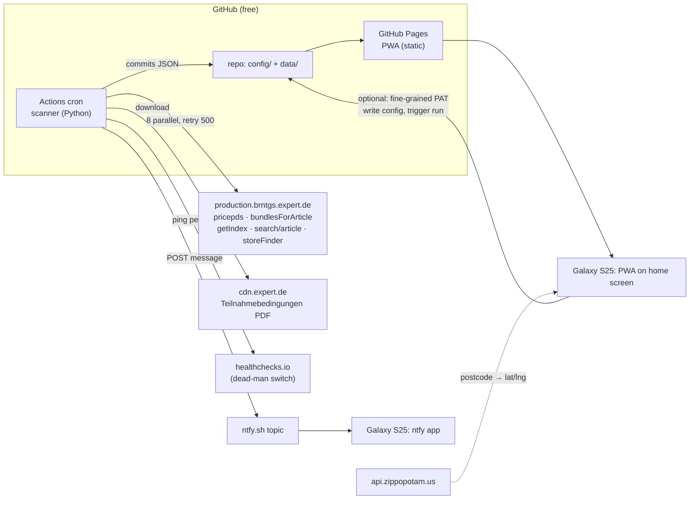
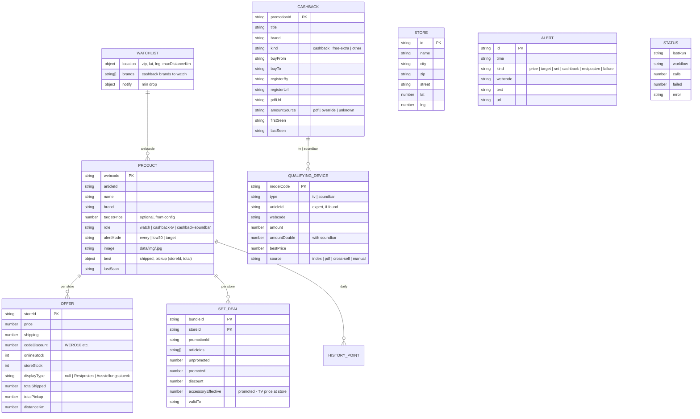

# expert-checker — plan

Status: draft for review, 2026-11-21, revised after the first review (German UI, Berlin location, redesigned prototype). Builds on [requirements.md](requirements.md) and [expert-api.md](expert-api.md). Feature list: [features.md](features.md). Clickable prototype: [prototype/index.html](../prototype/index.html), published at https://claude.ai/artifact/Cf3Y6zg8fAqWNPkKaELWdt (run locally with `python3 -m http.server 8765 --directory prototype`). Revised and final prototype (card B2, 2026-11-22): [prototype/b2.html](../prototype/b2.html), published at https://claude.ai/artifact/Y1dntJo3RAE6oRvnXTK2h2.

## 1. Decisions on the open questions

The open questions in requirements.md were analyzed with live API calls on 2026-11-21 (promotion index of the online shop, Freital and Pasternak; article lookups; the Sony and Samsung cashback PDFs). Results:

| # | Question | Decision | Evidence |
|---|---|---|---|
| 1 | Hosting | **GitHub Actions cron in a public repo.** Milestone 0 is a 3-day probe, because the API host *is* behind Cloudflare (`server: cloudflare`, `cf-ray`) and GitHub runners use Azure data-center IPs. Cloudflare Workers are ruled out: the free plan allows 50 external subrequests per invocation; a scan needs 349. Fallback if the probe fails: Oracle Cloud "Always Free" VM with cron (needs a card at signup, no charge). | Response headers of `pricepds`; Cloudflare Workers limits; GitHub Actions docs. |
| 2 | App type | **PWA on GitHub Pages + ntfy push (ntfy.sh, Android app).** Data = JSON files the scanner commits into the repo. The phone is a Samsung Galaxy S25 (Android, confirmed 2026-11-21), so web push has no iOS limits; it stays version 2 because the scanner would have to store push subscriptions and sign VAPID requests; ntfy needs one `POST`. | ntfy docs. |
| 3 | Cashback amounts | **Parse the Teilnahmebedingungen PDF on `cdn.expert.de`** that the promotion description links. Samsung and Sony PDFs hold model-code tables (`Modell-Code / Zoll / Cashback`, `Bezeichnung / SAP / Cashback / Double-Cashback`). `possibleDiscountRanges` is `null` for TV cashbacks (it is filled only for household appliances: Bosch, Siemens, AEG). Manual override file for unparsed brands. | PDFs of `e_4294` (Sony) and `e_4288` (Samsung Frame Pro); `compactPromotionData`. |
| 4 | Qualifying devices | **TVs: from `getIndex.indexed` (complete for expert's range). Soundbars: not linked** (Sony cashback `e_4294` → 8 TVs, 0 soundbars). Soundbar list comes from the PDF; expert articles for them are found through the TV article's `additionalArticles` cross-sell list (numeric ids → `search/article?articleId=e_<id>`), matched by model code. Manual add as fallback. | `indexed` reverse map; `search/article` response. |
| 5 | Samsung offers | At expert today: `e_4288` "Samsung Cashback" = **The Frame Pro Deals** (16.11.–6.12.2026, 130–250 €, TV only, 4 articles). `e_4309` "Samsung Black Weeks" is a marketing pill with 19 TVs and soundbars, no cashback. **Mix & Match (TV + sound device) ended 15.11.2026**; its PDF uses the same table layout as Frame Pro, so one Samsung parser covers both. Mix & Match rule confirmed: TV and soundbar may be bought at different retailers on different dates, registered together. | `globalPromotions`; Samsung Mix & Match and Frame Pro PDFs. |
| 6 | Discover offers without a product | **One `getIndex` call for the online shop per discovery run.** Store promotion sets are subsets of the online set (Freital: 3 online-only, Pasternak: 12 online-only, 0 store-only); the online-only ones are PayPal, PAYBACK and WERO10. | Diff of 3 indexes. |
| 7 | Store distance | **Postcode → coordinates with `api.zippopotam.us/de/<plz>`** once, stored in config. Store coordinates come from the store finder (348 stores with `latitude`/`longitude`). Haversine distance. | Tested with 01705 → Freital. |
| 8 | Other shops | Out of scope. Note: Samsung and Sony PDFs state "all participating retailers", so the cashback data model is shop-independent; a second price source could plug into the same offer. | PDFs. |

New API facts found during the analysis are recorded in [expert-api.md](expert-api.md) (section "Findings 2026-11-21").

### Decisions from the first review (2026-11-21, afternoon)

- **UI language German**, documentation English.
- **Location 14167 Berlin, radius 50 km.** Nearest stores: Berlin Tauentzien 4 km, Falkensee 21 km, Rangsdorf 25 km, Königs Wusterhausen 31 km, Fürstenwalde 50 km. Store names in the finder are partly generic ("ESC"); the app shows "expert <city>" plus postcode and street.
- **Alerts:** default = every price drop; per product switchable to target price or minimum drop (rule N1 changes accordingly).
- **Store links:** every store row links to `https://www.expert.de/shop/<webcode>-<slug>.html?branch_id=<store id>` and shows the postcode with a copy button, because the expert.de store picker works by postcode.
- **Online-Shop explained in the UI:** expert's central shop, ships from the central warehouse, own price, stock and codes (WERO10).
- **Product images:** `GET /api/search/article` → `primaryImage` id → `GET /api/medium/<id>` → `originalData` path → `https://cdn.expert.de/<originalData>`. Scanner stores a 640 px copy in `data/img/<webcode>.jpg`.
- **Product search:** no search endpoint exists (13 path variants probed, all `400 (Bad Request)` or `404`). Version 2 option: a name search over a cached article list built from the promotion index (17 841 article ids of the online shop, resolved once with `search/article`). Version 1 keeps the URL input.
- **Targets:** Philips 65OLED951 (webcode 11128346052, `e_977673`) and Sony BRAVIA 9 II 65"/75" (11128378730 / 11128379730). The Sony cashback (TV Winter 2026) covers BRAVIA 7 II and 8 II only; the 9 II has a set deal with the Theatre Bar 6 (−100 €) and no cashback.
- **Prototype design:** category-standard price-tracker look (white cards, product image per row, two prices side by side: Versand | Abholung, each naming its place; green = cheapest path), chosen by the user from a four-direction board. Design system recorded in DESIGN.md and .impeccable/design.json after the finish review (verdict: ship). Direction board (the four variants shown to the user): https://claude.ai/artifact/MJay7HjM79yGnRVh9SvQ26.
- **Prototype design, revised (2026-11-22):** the two-column price row is replaced by card B2. Card head: product image, name, subtitle, no price. Receipt rows: the cheapest path first (place, distance, stock, Aussteller badge, "kein Cashback" or "ohne Cashback"), the cashback deduction with its dates, the total "Dein Preis inkl. Cashback" (only with a cashback; otherwise the first row is the big price), the other path with "mit Cashback X €", set deals marked "nicht im Preis". Footer: 30-day sparkline of the daily best price, the movement ("−80 € seit gestern" or "−240 € in 30 Tagen") and the verdict ("Tiefstpreis seit 30 Tagen" or "60 € über dem 30-Tage-Tief von 3.399 €"); "Mehr" expands stores within the radius, the three cheapest shippers and all promotions including Zugaben. Green only when the effective price (after cashback) is the lowest of the last 30 days and at least 3 % under the 30-day high; the target price is optional. Product page: hero image, receipt rows and trend, cashback explanation, then Aktionen (cashback offer card, set deals, Zugaben), then alert settings, 30-day chart, stores as separate cards, shipping. The "Produkt hinzufügen" input moves to a plus button in the top bar. The list header hint "n am Tiefstpreis" is dropped. Prototype: prototype/b2.html, published at https://claude.ai/artifact/Y1dntJo3RAE6oRvnXTK2h2. Three-variant board (A Zwei Wege, B Bester Weg, C Preislage): prototype/variants.html, https://claude.ai/artifact/1dAJtj5qQMAKLFUqw5raxa.

### Decisions of 2026-11-22 (M0 planning)

- **Hosting stays a public repo.** On GitHub Free, a private repo gets $12 of compute per month (≈ 2 000 Linux minutes at $0.006/min; each job is rounded up to a whole minute; runs are blocked when the amount is used up), and GitHub Pages works only for public repos. The §3 schedule needs ≈ 2 100–3 000 minutes per month for 3–5 TVs. Also compared and rejected: public code + private data repo (two repos, personal docs must move, public logs must hide distances), Cloudflare Workers (free plan: 50 subrequests and 10 ms CPU per invocation, rewrite in JavaScript), Oracle Always Free VM (card, server upkeep, idle instances are reclaimed). The user accepts that the postcode, the watch list and the scan data are public.
- **Scan window 06:00–22:00 Berlin.** No scans at night: the first run at 06:15 picks up the changes of the night, and the user does not use the app at night. The schedules use the `timezone: "Europe/Berlin"` key of the Actions `schedule` event, so daylight saving time needs no code. No quiet hours (§5).
- **Data commits without `[skip ci]`.** Pushes with `GITHUB_TOKEN` start no workflow anyway, and `[skip ci]` can skip a branch-based Pages build (§7).
- **Commit address.** Commits in this repo use `81761762+moegelin@users.noreply.github.com` (repo-local git config), not the work address.
- **M0 probe.** Every run: store finder, 3 `pricepds` (Philips 65OLED951 at the Online-Shop, Sony BRAVIA 9 II 65" at Berlin Tauentzien, LG OLED65C69LB at Rangsdorf), `getIndex` of the Online-Shop. Sweep: `pricepds` for the Philips at all stores + Online-Shop (349 calls, 8 workers) in the first run and then when the last sweep is 6 h old, because 5 calls cannot show throttling at scan volume. The workflow runs hourly at :23 UTC around the clock and disables itself 72 h after the first run. A failed run turns red; the GitHub failure email is the alert until ntfy (M1).

### Hosting problems found 2026-11-22 (after the M0 probe)

The hosting of §1 #1 does not work. The decision follows below ("Hosting decision 2026-11-22"). §2 architecture, §3 hosting and §6 milestones still describe the Actions design; they are revised after the phone test passes.

Problems:

| # | Problem | Status | Evidence |
|---|---|---|---|
| P1 | **Cloudflare blocks data-centre traffic.** GitHub Actions gets `403 (Forbidden)` with `cf-mitigated: challenge` and a "Just a moment..." page on the first call, from two data centres. The same client from a home connection in Berlin works (all calls `200`). | verified for GitHub Actions | runs 45037047940 (`PDX`) and 45037122117 (`SEA`); docs/expert-api.md, "Findings 2026-11-22 (M0 probe)" |
| P2 | **Every other cloud host is probably blocked too:** Vercel (AWS), Netlify, Render, Fly, Google Cloud, Google Apps Script, and the planned fallback Oracle VM. Cloudflare Workers: Bot Fight Mode is known to challenge Workers subrequests; the free plan also allows only 50 subrequests per run (a scan needs 349). | not tested | Cloudflare Bot Fight Mode docs |
| P3 | **Free cloud plans are too small anyway.** Vercel Hobby: classic cron jobs once a day; Schedules at most every 15 min with up to 1 h jitter; functions at most 5 min. Google Apps Script: request quota per day below 5 TVs × 349 stores × hourly. | from docs | Vercel cron docs |
| P4 | **A browser app cannot call the API.** `access-control-allow-origin` is fixed to `https://www.expert.de`, so a PWA on another origin cannot read responses. A web app can only show data that something else scanned. | verified (`Origin: https://moegelin.github.io` → `access-control-allow-origin: https://www.expert.de`) | docs/expert-api.md, "Request behaviour" |
| P5 | **The Mac is no host.** It is not on all the time. | user, 2026-11-22 | |
| P6 | **The phone is the only free, always-on device with a home or mobile connection.** Risks: Samsung One UI kills background apps (sleeping apps; foreground services are guaranteed only since One UI 6 for apps targeting Android 14); mobile data not tested against Cloudflare (home Wi-Fi = same address as the Mac, works); data volume about 0.5–2 MB per product scan, set scans much more; without a server nothing outside the phone notices when scans stop. | not tested on the phone | dontkillmyapp.com/samsung |
| P7 | **Phone as Tailscale relay** (GitHub Actions routes expert calls through the phone as exit node): Android exit nodes run in userspace and "may be too slow"; the free plan limits the minutes of ephemeral nodes (1 000 per month per a third-party source, not checked). | not tested | Tailscale exit-node docs |
| P8 | **Process.** Hosting was not tested before the design and prototype work. Rule from now on: test that a path works end to end before building features on it. | lesson | |

Ruled out: getting past the Cloudflare challenge with automated browsers or solver tools (circumvents expert's protection, fragile); paid residential proxies (cost, same circumvention).

### Hosting decision 2026-11-22 (evening)

**The scanner runs on the Galaxy S25 in Termux.** Android's JobScheduler (through Termux:API) starts it hourly in the test and every 2 h in version 1, only 06:00–22:00 Berlin. healthchecks.io is the dead-man switch: a missed run sends an email and an ntfy push, and the user restarts Termux. The options against the constraints (free, not the Mac, every 2 h by day, keeps working or tells the user to restart it):

| Option | Passes Cloudflare | Free | 2 h schedule, 06–22 | Keeps working, tells the user when not | Effort |
|---|---|---|---|---|---|
| Any free cloud server (Vercel, Render, Fly, Oracle, Google, Workers, Apps Script) | No. Verified for Azure (GitHub Actions), every other free host is a data centre too | Yes | Free tiers too small: Vercel Hobby cron once a day, Workers 50 subrequests per run, Apps Script 20 000 fetches per day against ≈ 14 000 needed plus retries and set scans | n/a | low |
| Phone as Tailscale exit node + Actions | Yes, through the phone | Yes | Yes | Two things must stay up (phone VPN and Actions). Tailscale: Android exit nodes are "not performant" and "still undergoing optimization" | low, fragile |
| **Phone + Termux running the Python scanner** | Yes on Wi-Fi (verified at home, same address as the Mac); mobile data untested | Yes | Yes, JobScheduler, minimum period 15 min | Yes: Termux:Boot, wake lock per run, battery exemption, healthchecks ping | low, reuses scanner and tests |
| Native Android app (Kotlin, WorkManager) | Yes | Yes | Yes, WorkManager periodic work is the sanctioned pattern | Best background guarantees | high, full rewrite |
| Android app with Chaquopy around the Python scanner | Yes | Yes, Chaquopy is open source since 12.0.1 (2022-07) | Yes | Same as native | medium, keeps the Python |
| Old Android device at home | Yes | If the user owns one | Yes | Better than the S25: always on charger and Wi-Fi | low |
| idealo and mydealz alerts | n/a | Yes | n/a | n/a | none; no per-store prices, no cashback maths |

Why Termux: the smallest change that meets every constraint. The Tailscale relay depends on the phone being awake anyway and adds Actions and an experimental exit node. A native app only buys better background guarantees; the Chaquopy route gives the same guarantees later without discarding the Python, so it is the fallback if the phone test fails.

Battery, estimated: 8 runs a day with about 75 s of network each cost 2–3 % per day on Wi-Fi and 3–5 % on mobile data (S25, 4 000 mAh). Rules that keep it there: no permanent wake lock (the boot script only registers the job, the run script holds the lock for the run), JobScheduler instead of a sleep loop, set scans over all stores only on Wi-Fi or once a day, gzip (the client already sends `Accept-Encoding: gzip`; sizes in expert-api.md, "Request behaviour").

Consequences for the plan, to be written after the test: §2 scanner on the phone instead of Actions, data pushed to the repo with a fine-grained PAT, GitHub Pages and the PWA unchanged (P4 does not apply: the PWA reads only repo data), alerts from the phone through ntfy or `termux-notification`; §3 replaced by the phone setup; §6 M0 = the phone test below.

#### Phone test (M0, one day)

Files: `phone/setup.sh` (one-time setup in Termux), `phone/schedule.sh` (registers job 1: hourly, any network, persisted across reboots), `phone/boot.sh` (Termux:Boot runs schedule.sh again; no wake lock), `phone/run-probe.sh` (one run: skips 22:00–06:00 for scheduled runs, wake lock for the run, detects Wi-Fi or mobile data with `termux-wifi-connectioninfo`, runs `python -m scanner probe --out data/probe-phone.json --event schedule|manual --network …`, pings healthchecks.io, posts a notification, cancels the job when the 24 h window is over). The probe exits 0 (clean), 1 (degraded: a call failed after retries or a check failed, the run happened) or 2 (aborted: challenge, rate limit, too many failures). Only exit 2 or a crash pings `/fail` and rings; a degraded run pings success and updates the silent notification, because a flaky `500` on one of the fixed calls is an API problem, not a hosting problem (seen on the Mac on 2026-11-22: Sony BRAVIA 9 II at Berlin Tauentzien, four `500`s). Output: `data/probe-phone.json` (records and verdict, runner `termux`), `data/probe-phone.log` (one line per start, also the skipped night runs), `data/probe-phone-last.md` (output of the last run, ignored by git). The probe keeps the Actions behaviour; the runner comes from `TERMUX_VERSION`.

Pass = verdict `go` in `data/probe-phone.json` plus two manual checks:

1. No challenge, no non-JSON body, no aborted run, first-try `500` under 10 % (as for Actions).
2. At least one run on Wi-Fi and one on mobile data; manual runs count.
3. At least 15 of the 16 hourly scheduled runs between 06:00 and 22:00 Berlin within 24 h of the first run.
4. Manual: Settings → Battery shows Termux plus Termux:API under 5 % for the day.
5. Manual: healthchecks.io received the pings and sent no false alarm. Check settings: cron `0 6-21 * * *`, time zone Europe/Berlin, grace 2 h (JobScheduler runs anywhere inside the hour, so two consecutive misses alert, one does not; the log counts single misses).

Fail → Chaquopy app with WorkManager around the same Python package, then the same one-day test with that app.

Steps, in this order (1 and 2 done on 2026-11-22 by Claude; 3 to 7 need the user; the Actions `probe` workflow is disabled):

1. ~~Mac: commit and push these files.~~ Done, the phone clones the public repo `moegelin/expert-checker`.
2. ~~Mac: disable the Actions probe.~~ Done (`gh workflow disable probe.yml`, state `disabled_manually`).
3. Browser, healthchecks.io (free, no card, sign-up by email link): one check "expert-probe-phone". Schedule: cron `0 6-21 * * *`, time zone Europe/Berlin, grace 2 h. Integrations: email, and ntfy with a random topic name (treat it as a secret, do not commit it). Copy the ping URL (`https://hc-ping.com/<uuid>`).
4. Phone: install Termux, Termux:API and Termux:Boot from F-Droid (same signature; not the Play Store build). Open each once. Settings → Apps → each of the three → Battery → Unrestricted. Settings → Battery → Background usage limits → Never sleeping apps: add the three. Developer options → "Disable child process restrictions" on, if the option exists (it is missing on some One UI versions; the probe runs 2–3 processes, far below the limit of 32, so skip it then). Install the ntfy app and subscribe to the topic of step 3.
5. Termux: `pkg install -y git && git clone https://github.com/moegelin/expert-checker.git ~/expert-checker && bash ~/expert-checker/phone/setup.sh https://hc-ping.com/<uuid>` (ping URL of step 3 as the argument; already cloned → `cd ~/expert-checker && git pull` first). Termux has no `tzdata` package (first attempt failed on it, 2026-11-22); the script installs the pip package instead. The script installs packages, copies the boot script, runs the tests, registers the job and does the first run on the current network.
6. Termux: Wi-Fi off, `bash ~/expert-checker/phone/run-probe.sh manual`, Wi-Fi on. This is the mobile-data run of criterion 2.
7. Wait 24 h. The notification "expert probe ok" updates every hour; a failed run rings. After the window the notification "test finished" appears and the job cancels itself. Read `tail -n 30 ~/expert-checker/data/probe-phone.log` and `cat ~/expert-checker/data/probe-phone-last.md`; check criteria 4 and 5.
8. Termux: `cd ~/expert-checker && git config credential.helper store && git add data/probe-phone.json data/probe-phone.log && git commit -m "probe: phone test" && git push` (user name `moegelin`, password = a fine-grained PAT with Contents read/write on this repo). The same token later lets the scanner push its data.
9. Mac, new chat: evaluate with Claude; on `go`, revise §2, §3 and §6 for the phone and start M1; on `no-go` because of kills, the Chaquopy fallback.

State 2026-11-22 evening: probe changes, scripts and tests committed and pushed; nothing run on the phone yet.

## 2. Architecture

Components:

- **Scanner** (`scanner/`, Python 3.12, stdlib + `pypdf`): one CLI with subcommands `stores`, `prices`, `sets`, `cashback`, `notify`. Runs locally and in Actions. No framework, no database.
- **Repo as database**: `config/*.json` (user input), `data/*.json` (scanner output). Every run commits its data, without `[skip ci]` (see §1, 2026-11-22). Git history is the price history backup.
- **PWA** (`app/`, static HTML/JS, no build step): reads `data/*.json` with `fetch`, renders the four screens of the prototype, installable on the home screen. Writes config through the GitHub Contents API when a fine-grained token (scope: this repo, Contents read/write, Actions read/write) is stored in the app; otherwise the user edits `config/watchlist.json` on GitHub.
- **Push**: ntfy topic with a random name (treated as a secret: Actions secret `NTFY_TOPIC`). Messages carry title, price line, store, distance, and a click URL to the product page with `?branch_id=<store>`.
- **Dead-man switch**: `healthchecks.io` free plan (20 checks). Pings at the end of each run. Missed ping → email/ntfy. Covers the silent disable of scheduled workflows after 60 days without activity (the data commits count as activity, but the check is the safety net).

## 3. Hosting details

| Item | Choice | Why |
|---|---|---|
| Repo visibility | Public | Unlimited Actions minutes on standard runners. Private = 2000 min/month, hourly runs would exceed it. The repo holds no secrets: ntfy topic, healthchecks URL, and PAT are Actions secrets or on the phone. |
| Runner | `ubuntu-latest`, Python 3.12 | Fastest cold start, no Docker. |
| Run length | 1–4 min per run | 35 s per product for prices (349 stores, 8 workers), 60–90 s for set deals (bundles are 20–65 KB per store). |
| Schedule delays | Accepted | Actions cron may run 5–30 min late. No requirement for exact times. |
| Fallback | Oracle Cloud Always Free ARM VM + cron, same scanner CLI | Only if milestone 0 shows Cloudflare blocking. |

### Batch scan schedule (cron in Europe/Berlin through the `timezone` key; no scans 22:00–06:00)

| Workflow | Cron | Work per run | Calls per run (5 watched products) |
|---|---|---|---|
| `scan-prices` | `15 6-21 * * *` (hourly 06:15–21:15, 16 runs; no night run) | `pricepds` for every watched product × 349 stores + online; compute best shipped / pickup; diff; notify | ≈ 1 750 |
| `scan-sets` | `45 6-21/3 * * *` | `bundlesForArticle` only for stores that offer the product (≈ 190 of 349 for a TV); diff set deals; notify | ≈ 950, ≈ 40 MB |
| `scan-cashback` | `30 6-21/6 * * *` | 1 × `getIndex` (online shop, 1.2 MB); filter `CASHBACK` promotions for watched brands and watched articles; download new PDFs; parse amounts; resolve qualifying TVs with `search/article` (cached in `data/articles.json`); refresh best prices of qualifying devices the user picked | 1 + ≤ 50 |
| `refresh-stores` | `0 6 * * 1` (weekly) | store finder → `data/stores.json`; alert when count changes by > 10 % | 1 |
| `probe` (milestone 0 only) | `23 * * * *` in UTC, around the clock; disables itself 72 h after the first run | 1 store finder, 3 `pricepds`, 1 `getIndex`; log status, `cf-mitigated`/challenge detection; sweep: `pricepds` for one TV at all stores in the first run and every 6 h | 5, plus 349 per sweep |

Rules: 8 workers, retry `500` three times with 1–2 s delay, exponential backoff on `429 (Too Many Requests)`, abort the run when > 20 % of calls fail (and notify). More than 10 watched products → split `scan-prices` into a matrix of 10 products per job. The requirement "150 stores, then the rest 30 minutes later" is not needed on Actions; a full scan of one product takes 35 s.

## 4. Data model

All files are JSON in the repo. `config/` is written by the user (or the PWA), `data/` by the scanner only.

Files:

| File | Content | Writer |
|---|---|---|
| `config/watchlist.json` | `location`, `brands`, `notify`, `products[]` (`webcode`, `label`, `targetPrice`, `watchSets`) | user / PWA |
| `config/cashback-overrides.json` | amounts and devices for offers the parser could not read | user |
| `data/stores.json` | 348 stores + online shop | `refresh-stores` |
| `data/products/<webcode>.json` | product, offers, sets, best, history (90 daily points: best shipped, best pickup) | `scan-prices`, `scan-sets` |
| `data/cashbacks.json` | all cashback-like promotions seen in the last 30 days, with qualifying devices | `scan-cashback` |
| `data/articles.json` | cache `articleId` → `webcode`, `name`, `brand`, `additionalArticles` | `scan-cashback` |
| `data/alerts.json` | last 200 alerts (the PWA inbox) | all |
| `data/status.json` | last run per workflow | all |

Best price formulas (unchanged from requirements):

- `totalShipped = price + shipping − codeDiscount` (codes from `promotionPrice.cashbackDiscount`, online only), only when `onlineStock > 0`.
- `totalPickup = price`, only when `storeStock > 0` and `distanceKm ≤ maxDistanceKm`.
- `accessoryEffective = set.promotedPrice − TV price at the same store`.
- Restposten counts as a normal offer; `displayType` is shown as a badge.

## 5. Notification rules

Every rule writes an `ALERT` and sends one ntfy message. No scans run 22:00–06:00 Berlin (§1, 2026-11-22), so no message is sent at night; there are no quiet hours.

| # | Rule | Condition | Cooldown |
|---|---|---|---|
| N1 | Price drop | per product one of three modes: **every drop** (default; any decrease of the effective best price, after cashback, against the **previous scan**, so a drop after a rise counts too), **new 30-day low** (only when the effective best price is below every value of the last 30 days), **target price** (see N2, only when a target is set) | 6 h per product and channel |
| N2 | Target price | optional per product; effective best total (after cashback) ≤ `targetPrice`; again only after it rose above the target in between | per crossing |
| N3 | Restposten / display deal | a `Restposten` or display offer within `maxDistanceKm` is ≥ 15 % below the best regular offer | once per store and product |
| N4 | New set deal | new `bundleId` for a watched product at the online shop or a store within range, or `discount` grows by ≥ 20 € | once per bundle and store |
| N5 | New cashback | new `CASHBACK` promotion whose brand is in `brands`, or whose `indexed` articles include a watched product. Second message when amounts become known (PDF parsed or override added). Third message 3 days before `buyTo`. | once per event |
| N6 | Cashback device price | best price of a qualifying device the user picked (role `cashback-tv` / `cashback-soundbar`) drops (same thresholds as N1) | 6 h |
| N7 | Scan failure | run aborted, > 20 % failed calls, non-JSON response (Cloudflare challenge), store count change > 10 %, or no successful run for 3 h (healthchecks.io, with a cron schedule in Europe/Berlin, so the night pause is no failure) | 1 per 6 h |

Rises are shown in the app (sparkline, "X € über dem 30-Tage-Tief") and never pushed (decided 2026-11-22).

Message format: `LG OLED65C69LB: 1 294 € pickup (was 1 339 €) · expert Bischofswerda, 32 km` with click URL `…?branch_id=e_…`, tags for the kind, priority `high` for N2 and N7.

## 6. Milestones

| M | Name | Deliverable | Done when |
|---|---|---|---|
| **M0** | Hosting probe | `probe` workflow + `scanner/expert_api.py` (client with retry/backoff) | 3 days of hourly runs from Actions show JSON responses, no challenge, no aborted run, < 10 % `500` at the first attempt. Decision hosting = Actions or fallback. |
| **M1** | Price scanner + push | `stores`, `prices`, `notify`; `config/watchlist.json`; `data/products/*.json`; ntfy N1, N2, N3, N7; healthchecks | Watching 3 TVs for a week with correct best prices (checked against the website) and alerts on the phone. |
| **M2** | PWA v1 | `app/` with watch list and product detail (screens 1–2 of the prototype), home-screen install, settings with postcode, radius, PAT | App on the phone shows the data within 1 min of a run; adding a product URL in the app triggers a scan. |
| **M3** | Set deals | `sets`; per-store set deals in product detail; N4 | LG DSC9S set shows 199 € effective at Pasternak and "no set" at Bischofswerda (verified example). |
| **M4** | Cashback | `cashback`; PDF parsers Samsung + Sony; qualifying TVs from the index; soundbars via cross-sell + manual; cashback list and detail with resale calculator (screens 3–4); N5, N6; `cashback-overrides.json` | Sony `e_4294` shows 8 TVs with single/double amounts and 6 soundbars; Samsung Frame Pro shows 4 TVs with amounts; calculator gives effective TV cost. |
| **M5** | Hardening | 90-day history sparkline, alert inbox, matrix split for > 10 products, docs | 30 days without a silent failure. |

Version 1 = M0–M4. M5 and the version-2 items in [features.md](features.md) come after the first month of use.

## 7. Risks

| Risk | Impact | Mitigation |
|---|---|---|
| Cloudflare blocks Azure runner IPs | no scans | **Happened 2026-11-22** (M0 probe); see §1, "Hosting problems found 2026-11-22". The fallback VM is a data centre too and probably blocked |
| expert changes the API | silent wrong data | N7 on non-JSON or schema mismatch; verify endpoints and update expert-api.md |
| PDF layouts change | amounts unknown | parser reports "unknown", N5 still fires with the link; override file |
| GitHub disables the cron after 60 days | no scans | data commits keep the repo active; healthchecks catches it |
| Data commits do not reach GitHub Pages (M2) | the app shows old data | commits without `[skip ci]`; in M2, verify that a commit pushed with `GITHUB_TOKEN` updates Pages, else deploy Pages from the scanner workflow |
| ntfy.sh rate limits / outage | missed alerts | alerts are also in `data/alerts.json`, visible in the PWA |
| Private token on the phone | repo write access | fine-grained PAT limited to one repo, 90-day expiry; optional feature |
